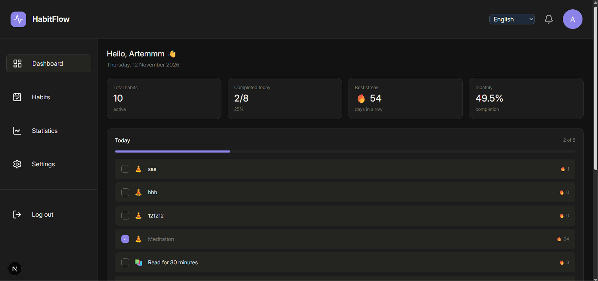
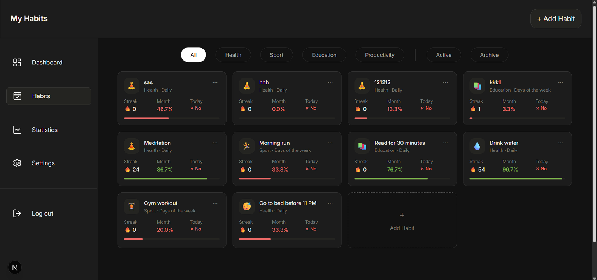
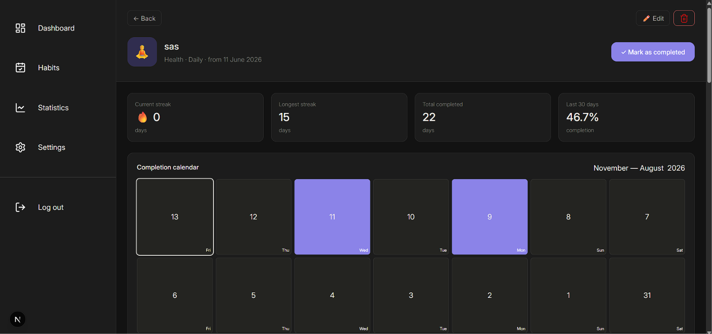

# Habit Tracker


A web app for tracking habits: daily check-ins, streaks, statistics and a completion calendar. The interface is available in Russian, Ukrainian and English.

**Live demo:** [<Vercel link>](https://habit-tracker-coral-nu-96.vercel.app/) · **Test account:** `demo@habit-tracker.dev` / `1234567890` (pre-filled with demo data)

## Screenshots





## Features

- Sign up and sign in with email/password or Google, password reset by email
- Create, edit, archive and delete habits (daily or on selected weekdays)
- Mark completion for today or for any day within the last three months via a calendar
- Current and best streak, 30-day completion rate, weekly chart
- User time zone: "today" is determined by the time zone saved in the profile
- Avatar upload, interface language switch (RU/UK/EN)
- Demo data for a quick start

## Tech stack

Next.js 16 (App Router) · React 19 · TypeScript (strict) · Tailwind CSS 4 · Supabase (Auth, Postgres, Storage) · TanStack Query · next-intl · Recharts · Vitest · GitHub Actions

## Technical decisions

- **Data security relies on RLS.** Postgres policies guarantee that a user can see and modify only their own rows. For the child table `habit_completions`, ownership is checked through the parent habit, so a foreign `habit_id` gives no access. Schema and policies: [`supabase/schema.sql`](supabase/schema.sql).
- **Calendar dates are stored and compared as `YYYY-MM-DD` strings.** A `Date` object is never created from such strings, because `new Date("2026-11-09")` means midnight UTC and shows the previous day in time zones west of UTC. Calculations use UTC date arithmetic (`Date.UTC`), formatting uses `timeZone: "UTC"`.
- **A single source of "today".** `getToday(timeZone)` determines the current date from the profile's time zone. This removed mismatches of "today" between different parts of the UI and 409 errors on the unique constraint `(habit_id, completion_date)`. Completion inserts are idempotent (`upsert` with `ignoreDuplicates`).
- **One request instead of N.** Habits are fetched together with their completions via PostgREST embedding, and card statistics are computed on the client from that data instead of separate requests per card.
- **Server-side session check + initial data in the cache.** The user fetched on the server in the layout is put into the TanStack Query cache, so client hooks don't make a repeated Auth request. Queries have a `staleTime`, so there are no needless refetches on window focus.
- **Time zone for Google accounts** is synchronized when the dashboard opens: a database trigger creates the profile with `UTC`, and the client updates it once from the device time zone.

## Getting started

Requires Node.js 22 and a Supabase project.

```bash
git clone https://github.com/arti21-debug/habit-tracker.git
cd habit-tracker
npm ci
```

Create `.env.local`:

```env
NEXT_PUBLIC_SUPABASE_URL=https://<your-project>.supabase.co
NEXT_PUBLIC_SUPABASE_PUBLISHABLE_KEY=<your-publishable-key>
```

Create the database structure, policies and trigger from [`supabase/schema.sql`](supabase/schema.sql) (run it in the SQL Editor of a new project). Then create the `avatars` storage bucket and, optionally, configure Google OAuth in Supabase.

```bash
npm run dev
```

## Scripts

| Command | Description |
|---|---|
| `npm run dev` | start the development server |
| `npm run build` | production build (includes type checking) |
| `npm run lint` | run ESLint |
| `npm test` | run unit tests (Vitest) |

## Tests and CI

Unit tests cover the date-related pure logic where real bugs used to occur: `getToday` (three time zones), `addDaysIso` (month and year boundaries, leap year), the 30-day completion rate (boundary dates) and streaks. On every push and pull request, GitHub Actions runs `lint`, tests and `build`.

## Project structure

```
src/
  app/        Next.js routes (App Router), layouts, metadata
  features/   screens and large components by area (auth, habits, dashboard, setting)
  hooks/      data hooks (TanStack Query) and logic
  lib/        Supabase access, database queries
  utils/      pure functions: dates, streaks, statistics (covered by tests)
supabase/     database schema snapshot and RLS policies
```

## Known limitations

I did a full code review of the project and fixed the critical issues. The rest is deliberately left for future iterations.

- **Data is loaded on the client.** Pages are thin server wrappers around client components: the server checks the session and picks the language, while the browser fetches data through TanStack Query. It works, but doesn't use the main benefit of SSR — HTML rendered with data. *Plan:* load data in Server Components and move mutations to Server Actions with `revalidatePath`, or use `prefetchQuery` + `HydrationBoundary`.
- **The data layer (`lib/`) only works with the browser Supabase client**, with no runtime validation (zod) and no generated database types. *Plan:* server-side functions with `server-only` and `supabase gen types`.
- **A habit's schedule does not affect statistics.** Streaks count consecutive days, so streaks of weekday-based habits don't grow. The 30-day rate and the monthly rate on the dashboard ignore the schedule and the habit's creation date. Demo data uses daily habits. *Plan:* take `days` and `created_at` into account and move the calculations into pure functions with tests.
- **Category and frequency values** are stored in the database as Russian strings without `check` constraints. *Plan:* stable keys (`health`, `daily`) with translation at display time.
- **Email confirmation links** only work in the browser where the sign-up happened (PKCE). *Plan:* `token_hash` + `verifyOtp`.
- **Avatar upload:** the client only checks `accept="image/*"`, and the bucket has no size or file type limits.