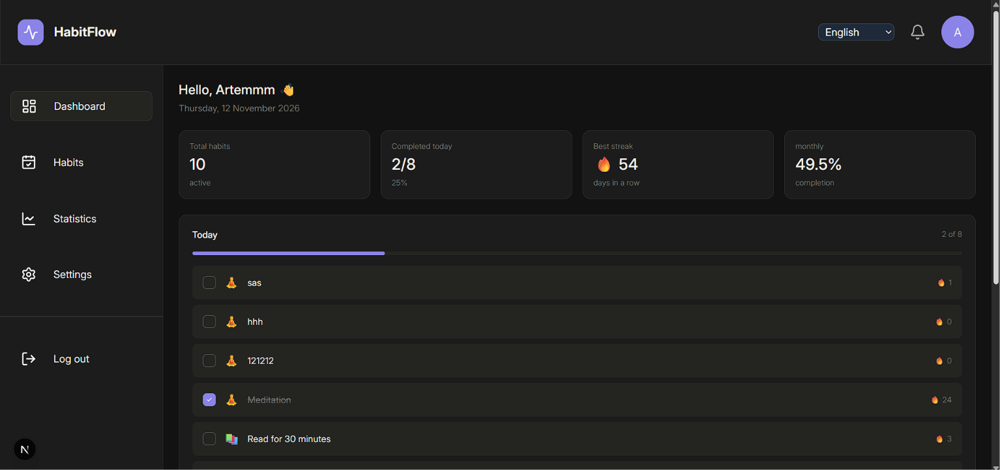
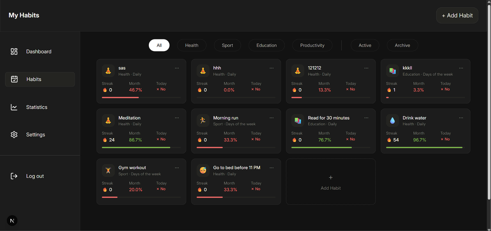
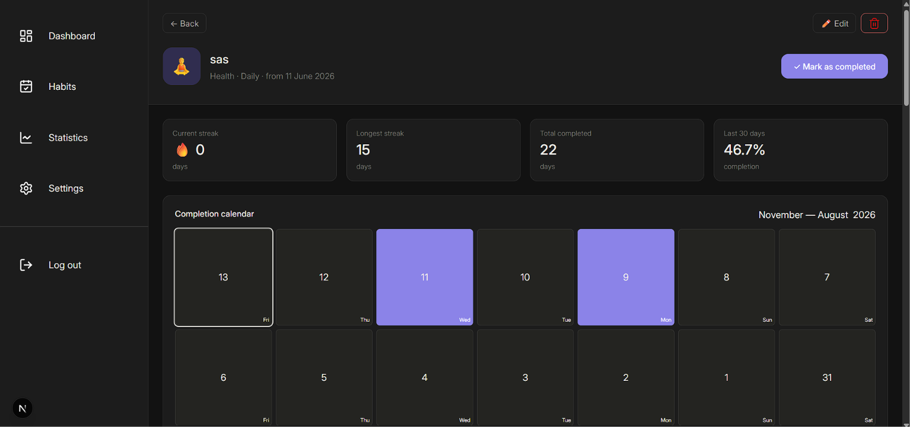

# Habit Tracker


A web app for tracking habits: daily check-ins, streaks, statistics and a completion calendar. The interface is available in Russian, Ukrainian and English.

**Live demo:** https://habit-tracker-coral-nu-96.vercel.app/ · **Test account:** `demo@habit-tracker.dev` / `1234567890` (pre-filled with demo data)

## Screenshots





## Features

- Sign up and sign in with email/password or Google, password reset by email
- Create, edit, archive and delete habits (daily or on selected weekdays)
- Mark completion for today or for any day within the last three months via a calendar
- Current and best streak, 30-day completion rate, weekly chart; all of it respects the habit's schedule
- User time zone: "today" is determined by the time zone saved in the profile
- Avatar upload (PNG/JPEG/WebP up to 2 MB), interface language switch (RU/UK/EN)
- Demo data for a quick start

## Tech stack

Next.js 16 (App Router) · React 19 · TypeScript (strict) · Tailwind CSS 4 · Supabase (Auth, Postgres, Storage) · TanStack Query · next-intl · Recharts · Vitest · GitHub Actions

## Technical decisions

- **Data security relies on RLS.** Postgres policies guarantee that a user can see and modify only their own rows. For the child table `habit_completions`, ownership is checked through the parent habit, so a foreign `habit_id` gives no access. Schema and policies: [`supabase/schema.sql`](supabase/schema.sql).
- **Calendar dates are stored and compared as `YYYY-MM-DD` strings.** A `Date` object is never created from such strings, because `new Date("2026-11-09")` means midnight UTC and shows the previous day in time zones west of UTC. Calculations use UTC date arithmetic (`Date.UTC`), formatting uses `timeZone: "UTC"`.
- **A single source of "today".** `getToday(timeZone)` determines the current date from the profile's time zone. This removed mismatches of "today" between different parts of the UI and 409 errors on the unique constraint `(habit_id, completion_date)`. Completion inserts are idempotent (`upsert` with `ignoreDuplicates`).
- **One request instead of N.** Habits are fetched together with their completions via PostgREST embedding, and card statistics are computed on the client from that data instead of separate requests per card.
- **Server-side session check + initial data in the cache.** The user fetched on the server in the layout is put into the TanStack Query cache, so client hooks don't make a repeated Auth request. Queries have a `staleTime`, so there are no needless refetches on window focus.
- **Time zone for Google accounts** is synchronized when the dashboard opens: a database trigger creates the profile with `UTC`, and the client updates it once from the device time zone.
- **Statistics respect the habit's schedule.** Streaks and completion rates are pure functions over scheduled days (`utils/schedule.ts`) and are covered by unit tests. A scheduled day that is still today and not yet marked doesn't break the streak.
- **Server-side data loading on the habits page.** A Server Component fetches the habits and the profile and passes them into the TanStack Query cache via `HydrationBoundary`: the HTML arrives with the list already rendered, and the database query on page open runs once, on the server.
- **Type-safe database access.** Types are generated using `supabase gen types`, Supabase clients are typed with the `Database` generic, and user input is validated with Zod.

## Getting started

Requires Node.js 20.19+ or 22.12+ and a Supabase project.

```bash
git clone https://github.com/arti21-debug/habit-tracker.git
cd habit-tracker
npm ci
```

Copy the environment variables template and add the values from your Supabase project (Project Settings → API):

```bash
cp .env.example .env.local
```

```env
NEXT_PUBLIC_SUPABASE_URL=https://<your-project>.supabase.co
NEXT_PUBLIC_SUPABASE_PUBLISHABLE_KEY=<your-publishable-key>
```

Create the database structure, policies and trigger from [`supabase/schema.sql`](supabase/schema.sql) (run it in the SQL Editor of a new project). Then create the `avatars` storage bucket and, optionally, configure Google OAuth in Supabase.

```bash
npm run dev
```

## Scripts

| Command | Description |
|---|---|
| `npm run dev` | start the development server |
| `npm run build` | production build (includes type checking) |
| `npm run lint` | run ESLint |
| `npm test` | run unit tests (Vitest) |

## Tests and CI

Unit tests cover the date and schedule pure logic where real bugs used to occur: `getToday` (three time zones), `addDaysIso` (month and year boundaries, leap year), the habit schedule (`isScheduledOn`, `getScheduledDates`), streaks over scheduled days and the 30-day completion rate (boundary dates). On every push and pull request, GitHub Actions runs `lint`, tests and `build`.

## Project structure

```
src/
  app/        Next.js routes (App Router), layouts, metadata
  features/   screens and large components by area (auth, habits, dashboard, setting)
  hooks/      data hooks (TanStack Query) and logic
  lib/        Supabase access, database queries
  utils/      pure functions: dates, schedule, streaks, statistics (covered by tests)
supabase/     database schema snapshot and RLS policies
```

## Known limitations

I did a full code review of the project and fixed the critical issues. The rest is deliberately left for future iterations.

- **Some pages still load data on the client.** The habits list fetches data on the server (Server Component + `prefetchQuery` / `HydrationBoundary`) and arrives as ready HTML, while the other pages (dashboard, habit page, settings) are still loaded in the browser via TanStack Query. *Plan:* move the remaining pages and mutations to Server Actions with `revalidatePath`; for the dashboard, first compute "today" from the profile's time zone to avoid hydration mismatches.
- **No dedicated repository layer for data access.** DB types are generated from the Supabase schema (`npm run types`), clients are typed, and user input is validated with a zod schema before it is written. *Plan:* extract data access into a repository layer and move mutations to Server Actions.
- **Statistics simplifications.** The completion rate ignores the habit's creation date, so for a new habit it is understated during the first month: it is divided by all scheduled days in the window. Schedule history isn't stored, so after changing the weekdays, past streaks and rates are recalculated using the new schedule. *Plan:* clamp the window to the creation date and store schedule history.
- **Category and frequency values** are stored in the database as Russian strings without `check` constraints. *Plan:* stable keys (`health`, `daily`) with translation at display time.
- **Email confirmation links** only work in the browser where the sign-up happened (PKCE). *Plan:* `token_hash` + `verifyOtp`.