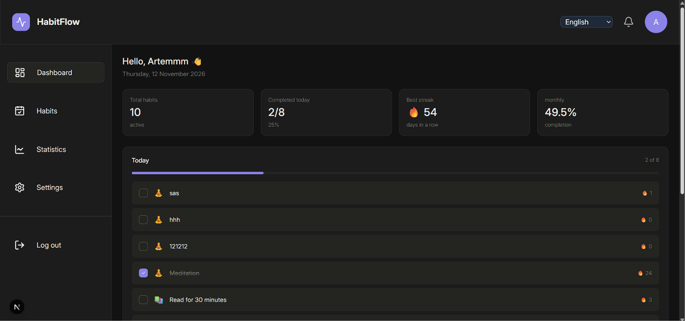
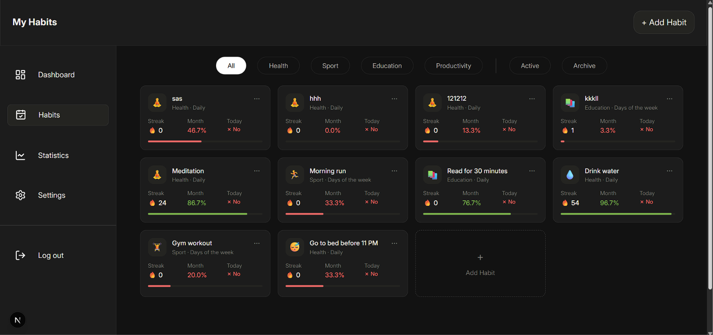
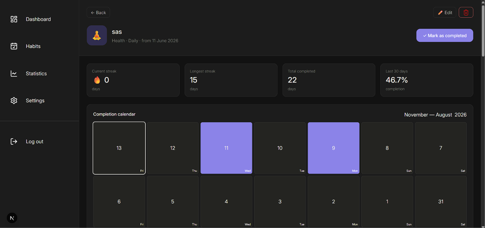

# Habit Tracker


Веб-приложение для отслеживания привычек: отметки по дням, серии (streaks), статистика и календарь выполнения. Интерфейс на русском, украинском и английском.

**Демо:** https://habit-tracker-coral-nu-96.vercel.app/ · **Тестовый аккаунт:** `demo@habit-tracker.dev` / `1234567890` (с заполненными демо-данными)

## Скриншоты





## Возможности

- Регистрация и вход по email/паролю и через Google, сброс пароля по письму
- Создание, редактирование, архивация и удаление привычек (ежедневные и по дням недели)
- Отметка выполнения за сегодня и за любой день трёх последних месяцев в календаре
- Текущая и лучшая серия, процент выполнения за 30 дней, график по неделям; всё с учётом расписания привычки
- Часовой пояс пользователя: «сегодня» определяется по его профилю
- Загрузка аватара (PNG/JPEG/WebP до 2 МБ), смена языка интерфейса (RU/UK/EN)
- Демо-данные для быстрого знакомства

## Стек

Next.js 16 (App Router) · React 19 · TypeScript (strict) · Tailwind CSS 4 · Supabase (Auth, Postgres, Storage) · TanStack Query · next-intl · Recharts · Vitest · GitHub Actions

## Технические решения

- **Безопасность данных держится на RLS.** Политики Postgres гарантируют, что пользователь видит и меняет только свои строки. Для дочерней таблицы `habit_completions` владелец проверяется через родительскую привычку, поэтому чужой `habit_id` ничего не даст. Схема и политики: [`supabase/schema.sql`](supabase/schema.sql).
- **Календарные даты хранятся и сравниваются как строки `YYYY-MM-DD`.** Объект `Date` не создаётся из таких строк, потому что `new Date("2026-11-09")` означает полночь по UTC и в часовых поясах западнее UTC даёт соседний день. Подсчёты идут арифметикой над датами в UTC (`Date.UTC`), форматирование с `timeZone: "UTC"`.
- **Единый источник «сегодня».** Функция `getToday(timeZone)` определяет текущую дату по часовому поясу из профиля. Это исключило расхождение «сегодня» между разными частями интерфейса и ошибки 409 на уникальном ограничении `(habit_id, completion_date)`. Вставка отметки идемпотентна (`upsert` с `ignoreDuplicates`).
- **Один запрос вместо N.** Привычки загружаются вместе с выполнениями через встроенную выборку PostgREST, статистика карточек считается на клиенте из этих данных, а не отдельными запросами на каждую карточку.
- **Серверная проверка сессии + начальные данные в кэше.** Пользователь, полученный на сервере в layout, кладётся в кэш TanStack Query, поэтому клиентские хуки не делают повторный запрос к Auth. У запросов задан `staleTime`, лишних перезагрузок при фокусе окна нет.
- **Часовой пояс для Google-аккаунтов** синхронизируется при заходе на дашборд: триггер в БД создаёт профиль с `UTC`, а клиент один раз обновляет его по поясу устройства.
- **Статистика учитывает расписание привычки.** Серии и проценты считаются чистыми функциями по запланированным дням (`utils/schedule.ts`) и покрыты unit-тестами. Сегодняшний запланированный день, который ещё не отмечен, серию не обрывает.
- **Серверная загрузка данных на странице привычек.** Server Component получает привычки и профиль и передаёт их в кэш TanStack Query через `HydrationBoundary`: HTML приходит с готовым списком, а запрос к БД при открытии страницы выполняется один раз на сервере.

## Запуск локально

Требуется Node.js 20.19+ или 22.12+ и проект в Supabase.

```bash
git clone https://github.com/arti21-debug/habit-tracker.git
cd habit-tracker
npm ci
```

Скопируйте шаблон переменных окружения и впишите значения из своего проекта Supabase (Project Settings → API):

```bash
cp .env.example .env.local
```

```env
NEXT_PUBLIC_SUPABASE_URL=https://<your-project>.supabase.co
NEXT_PUBLIC_SUPABASE_PUBLISHABLE_KEY=<your-publishable-key>
```

Структуру БД, политики и триггер создайте по [`supabase/schema.sql`](supabase/schema.sql) (выполнить в SQL Editor нового проекта). Затем бакет `avatars` и OAuth Google (по желанию) в настройках Supabase.

```bash
npm run dev
```

## Скрипты

| Команда         | Что делает                                  |
| --------------- | ------------------------------------------- |
| `npm run dev`   | запуск в режиме разработки                  |
| `npm run build` | production-сборка (включает проверку типов) |
| `npm run lint`  | ESLint                                      |
| `npm test`      | unit-тесты (Vitest)                         |

## Тесты и CI

Unit-тесты покрывают чистую логику с датами и расписанием, где раньше были реальные ошибки: `getToday` (три часовых пояса), `addDaysIso` (границы месяца, года, високосный год), расписание привычки (`isScheduledOn`, `getScheduledDates`), серии по запланированным дням и процент за 30 дней (граничные даты). GitHub Actions на каждый push и pull request запускает `lint`, тесты и `build`.

## Структура проекта

```
src/
  app/        маршруты Next.js (App Router), layouts, metadata
  features/   экраны и крупные компоненты по областям (auth, habits, dashboard, setting)
  hooks/      хуки данных (TanStack Query) и логики
  lib/        работа с Supabase, запросы к БД
  utils/      чистые функции: даты, расписание, серии, статистика (покрыты тестами)
supabase/     снимок схемы БД и политик RLS
```

## Известные ограничения

Я провёл полное ревью проекта и закрыл критичное. Остальное осознанно оставлено на следующие итерации.

- **Часть страниц загружает данные на клиенте.** Список привычек получает данные на сервере (Server Component + `prefetchQuery` / `HydrationBoundary`) и приходит в браузер готовым HTML, а остальные страницы (дашборд, страница привычки, настройки) ещё загружаются в браузере через TanStack Query. *План:* перенести остальные страницы и мутации на Server Actions с `revalidatePath`; для дашборда сначала считать «сегодня» по часовому поясу профиля, чтобы избежать расхождений при гидратации.
- **Слой данных (`lib/`) работает только через браузерный клиент Supabase**, нет runtime-валидации (zod) и сгенерированных типов БД. _План:_ серверные функции с `server-only` и `supabase gen types`.
- **Упрощения в статистике.** Процент выполнения не учитывает дату создания привычки: у новой привычки в первый месяц он занижен, потому что делится на все запланированные дни окна. История расписания не хранится, поэтому после изменения дней недели прошлые серии и проценты пересчитываются по новому расписанию. _План:_ ограничивать окно датой создания, хранить историю изменений расписания.
- **Значения категорий и частоты** хранятся в БД как русские строки без `check`-ограничений. _План:_ стабильные ключи (`health`, `daily`) и перевод при отображении.
- **Подтверждение email по ссылке** работает только в браузере, где шла регистрация (PKCE). _План:_ `token_hash` + `verifyOtp`.
