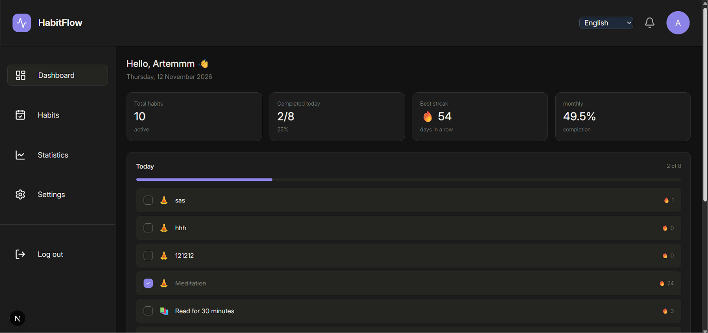
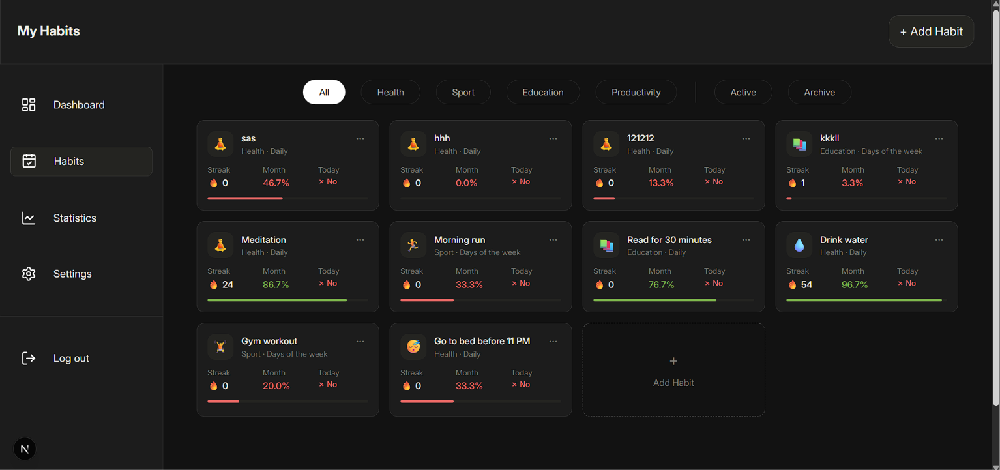
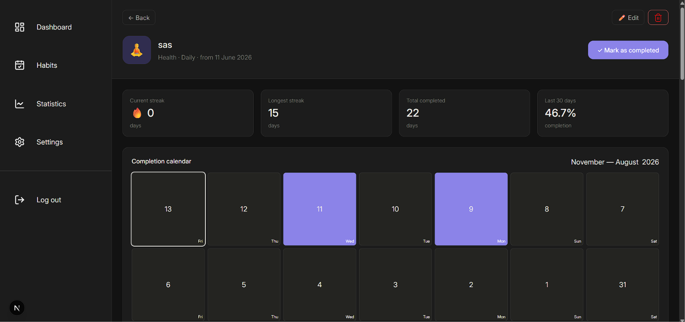

# Habit Tracker


Веб-приложение для отслеживания привычек: отметки по дням, серии (streaks), статистика и календарь выполнения. Интерфейс на русском, украинском и английском.

**Демо:** [<ссылка на Vercel>](https://habit-tracker-coral-nu-96.vercel.app/) · **Тестовый аккаунт:** `demo@habit-tracker.dev` / `1234567890` (с заполненными демо-данными)

## Скриншоты





## Возможности

- Регистрация и вход по email/паролю и через Google, сброс пароля по письму
- Создание, редактирование, архивация и удаление привычек (ежедневные и по дням недели)
- Отметка выполнения за сегодня и за любой день трёх последних месяцев в календаре
- Текущая и лучшая серия, процент выполнения за 30 дней, график по неделям
- Часовой пояс пользователя: «сегодня» определяется по его профилю
- Загрузка аватара, смена языка интерфейса (RU/UK/EN)
- Демо-данные для быстрого знакомства

## Стек

Next.js 16 (App Router) · React 19 · TypeScript (strict) · Tailwind CSS 4 · Supabase (Auth, Postgres, Storage) · TanStack Query · next-intl · Recharts · Vitest · GitHub Actions

## Технические решения

- **Безопасность данных держится на RLS.** Политики Postgres гарантируют, что пользователь видит и меняет только свои строки. Для дочерней таблицы `habit_completions` владелец проверяется через родительскую привычку, поэтому чужой `habit_id` ничего не даст. Схема и политики: [`supabase/schema.sql`](supabase/schema.sql).
- **Календарные даты хранятся и сравниваются как строки `YYYY-MM-DD`.** Объект `Date` не создаётся из таких строк, потому что `new Date("2026-11-09")` означает полночь по UTC и в часовых поясах западнее UTC даёт соседний день. Подсчёты идут арифметикой над датами в UTC (`Date.UTC`), форматирование с `timeZone: "UTC"`.
- **Единый источник «сегодня».** Функция `getToday(timeZone)` определяет текущую дату по часовому поясу из профиля. Это исключило расхождение «сегодня» между разными частями интерфейса и ошибки 409 на уникальном ограничении `(habit_id, completion_date)`. Вставка отметки идемпотентна (`upsert` с `ignoreDuplicates`).
- **Один запрос вместо N.** Привычки загружаются вместе с выполнениями через встроенную выборку PostgREST, статистика карточек считается на клиенте из этих данных, а не отдельными запросами на каждую карточку.
- **Серверная проверка сессии + начальные данные в кэше.** Пользователь, полученный на сервере в layout, кладётся в кэш TanStack Query, поэтому клиентские хуки не делают повторный запрос к Auth. У запросов задан `staleTime`, лишних перезагрузок при фокусе окна нет.
- **Часовой пояс для Google-аккаунтов** синхронизируется при заходе на дашборд: триггер в БД создаёт профиль с `UTC`, а клиент один раз обновляет его по поясу устройства.

## Запуск локально

Требуется Node.js 22 и проект в Supabase.

```bash
git clone https://github.com/arti21-debug/habit-tracker.git
cd habit-tracker
npm ci
```

Создайте `.env.local` (имена возьмите из вашего `.env.local`, ниже пример):

```env
NEXT_PUBLIC_SUPABASE_URL=https://<your-project>.supabase.co
NEXT_PUBLIC_SUPABASE_PUBLISHABLE_KEY=<your-publishable-key>
```

Структуру БД, политики и триггер создайте по [`supabase/schema.sql`](supabase/schema.sql) (выполнить в SQL Editor нового проекта). Затем бакет `avatars` и OAuth Google (по желанию) в настройках Supabase.

```bash
npm run dev
```

## Скрипты

| Команда | Что делает |
|---|---|
| `npm run dev` | запуск в режиме разработки |
| `npm run build` | production-сборка (включает проверку типов) |
| `npm run lint` | ESLint |
| `npm test` | unit-тесты (Vitest) |

## Тесты и CI

Unit-тесты покрывают чистую логику с датами, где раньше были реальные ошибки: `getToday` (три часовых пояса), `addDaysIso` (границы месяца, года, високосный год), процент за 30 дней (граничные даты) и серии. GitHub Actions на каждый push и pull request запускает `lint`, тесты и `build`.

## Структура проекта

```
src/
  app/        маршруты Next.js (App Router), layouts, metadata
  features/   экраны и крупные компоненты по областям (auth, habits, dashboard, setting)
  hooks/      хуки данных (TanStack Query) и логики
  lib/        работа с Supabase, запросы к БД
  utils/      чистые функции: даты, серии, статистика (покрыты тестами)
supabase/     снимок схемы БД и политик RLS
```

## Известные ограничения

Я провёл полное ревью проекта и закрыл критичное. Остальное осознанно оставлено на следующие итерации.

- **Данные загружаются на клиенте.** Страницы — тонкие серверные обёртки над клиентскими компонентами: сервер проверяет сессию и выбирает язык, а данные получает браузер через TanStack Query. Это работает, но не использует главное преимущество SSR — готовый HTML с данными. *План:* загрузка в Server Components, мутации через Server Actions с `revalidatePath` либо `prefetchQuery` + `HydrationBoundary`.
- **Слой данных (`lib/`) работает только через браузерный клиент Supabase**, нет runtime-валидации (zod) и сгенерированных типов БД. *План:* серверные функции с `server-only` и `supabase gen types`.
- **Расписание привычки не влияет на статистику.** Серии считаются по подряд идущим дням, поэтому у привычек по дням недели серия не растёт. Процент за 30 дней и месячный процент на дашборде не учитывают расписание и дату создания. Демо-данные созданы с ежедневными привычками. *План:* учитывать `days` и `created_at`, вынести расчёты в чистые функции с тестами.
- **Значения категорий и частоты** хранятся в БД как русские строки без `check`-ограничений. *План:* стабильные ключи (`health`, `daily`) и перевод при отображении.
- **Подтверждение email по ссылке** работает только в браузере, где шла регистрация (PKCE). *План:* `token_hash` + `verifyOtp`.
- **Загрузка аватара:** на клиенте проверяется только `accept="image/*"`, у бакета нет лимитов размера и типа файла.